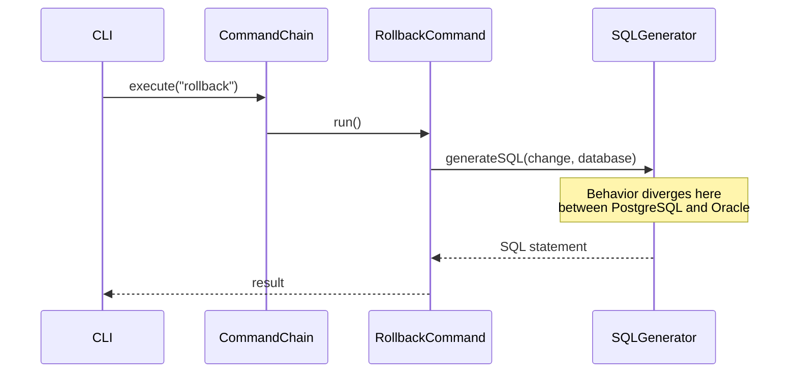

# Issue Resolution & Community Collaboration

## Every Contribution Matters

Liquibase Community is built by and for its community. Every bug report, fix, and idea you bring makes it better. We're glad you're here, whether this is your first time or you've been contributing for years.

## Understanding Team Capacity

Liquibase Community is a community-driven project. We rely on, and deeply value, the community's help to keep the project moving forward.

The Liquibase team is committed to:

- Triaging issues and providing initial feedback
- Guiding community contributors who are working on a fix
- Reviewing analyses, pull requests, and test contributions
- Answering questions on issue threads and [Discord](https://discord.gg/pDB5DfE){:target="_blank"}
- Implementing fixes when team capacity and priorities allow, focusing on severity and community impact

The fixes that happen fastest are the ones the community gets behind, and there are many ways to help that do not require writing a full fix.

## How the Community Can Help

The difference between an issue that gets resolved quickly and one that sits for months often comes down to community engagement.

### If You Are a Liquibase User

You do not need a development background to make a meaningful contribution. Here are things any Liquibase user can do:

**Document the behavior in detail**

Rather than just reporting "it doesn't work," share as much context as possible:

- The exact inputs you provided (changelog, command, configuration)
- The exact output or error you received
- What you expected to happen instead
- Whether the behavior changes with different Liquibase versions or environments

**Tell us which versions and tools you've tried**

- Does the problem exist in older or newer Liquibase versions? If it worked before and broke recently, that is a useful signal.
- Does it happen with the CLI but not with Maven, Gradle, or Spring Boot? Or vice versa?
- Share what you know, even if it is just one data point. Even a comment like "I can only reproduce this with the CLI, not with Maven" is exactly the kind of information that shapes how a fix is approached.

**Describe scenarios worth testing**

Think about the scenarios that triggered the bug. What were you doing? What inputs, configurations, or sequences of steps were involved? Are there related scenarios that a fix should also handle correctly?

Sharing these in plain language, even informally, is genuinely useful. A developer writing tests can use your scenarios directly as a checklist. For example:

> "This happens when `createTable` runs on a schema that already exists. It would also be worth checking: what happens if the table exists but with different columns? What if the schema name contains special characters?"

**Share potential impact on your workflow**

Before a fix is implemented, it helps to think about what else might be affected:

- Are there other commands or operations that do something similar and might be impacted?
- Have you seen related behavior elsewhere in Liquibase that a fix might accidentally change?
- Is this something many teams are likely to rely on, or a rare edge case?

A short comment, even an informal one, is genuinely useful and helps contributors make safer changes.

### If You Have Access to Multiple Databases or Environments

When a bug is reported, it is often unclear whether it affects one database, several, or all of them. If you have access to more than one database or environment, sharing your findings helps everyone understand the scope and urgency of the issue.

- **Test across database types** and share what you find. For example: "I confirmed this also happens on MySQL, it is not just PostgreSQL."
- **Test across Liquibase versions** and note which ones are affected. If it worked before and broke recently, identifying the version is a useful signal.
- **Test across the tools you use** (CLI, Maven plugin, Gradle plugin, Spring Boot) and note any differences in behavior.
- **Describe how common the scenario is.** For example, "this is a pattern many teams use" vs. "this is a very specific edge case in our setup" helps the team and community prioritize.

None of these require a technical background. You are simply sharing your own experience.

### If You Are Familiar with the Liquibase Community Codebase

If you have some familiarity with the codebase, you can go deeper with analysis and risk assessment, both of which directly accelerate the path to a fix.

**Provide a code-level analysis**

- Identify which class, method, or module is likely involved
- Describe what is happening vs. what should happen at the code level
- Trace the execution flow for the failing scenario with a sequence diagram

Sequence diagrams are particularly valuable for understanding complex interactions. For example, if a `rollback` command behaves differently across two databases, a diagram tracing the call chain can pinpoint exactly where the paths diverge:

You do not need to be a developer to produce a useful diagram. Even a hand-drawn flow of "I did X, then Y happened, but I expected Z" communicates valuable information on its own.

**Assess the risk of a fix**

Think through what else a fix might affect:

- **Affected areas of code:** which classes, modules, or components would a fix need to touch?
- **Regression risk:** could changing this behavior break other scenarios? Which tests or use cases might be affected?
- **Changelog compatibility:** could the fix change how existing changelogs are interpreted or cause checksum differences?
- **Extension and API impact:** does the fix touch any public APIs or extension points that downstream projects depend on?

A risk assessment does not need to be exhaustive. Even a short note like "this seems to only affect snapshot generation for PostgreSQL and should not change behavior for other databases" gives meaningful guidance to anyone planning to implement or review the fix.

### If You Are a Java Developer

If you can write Java, one of the highest-value contributions you can make is tests, even without a full fix. Tests:

- **Document the bug:** a clear, reproducible test case is proof the problem exists
- **Prevent regressions:** once a fix is in, tests ensure the problem does not silently come back
- **Accelerate review:** well-covered changes are easier to evaluate and merge with confidence

Liquibase Community uses the [Spock testing framework](https://spockframework.org/){:target="_blank"} for both unit and integration tests. See our guides for:

- [Writing unit tests](test-your-code/unit-tests.md)
- [Writing integration tests](test-your-code/integration-tests.md)

!!! tip
    A pull request that only adds a failing test to demonstrate a bug, with no fix yet, is a welcome and valuable contribution. It reduces uncertainty for whoever picks up the fix next.

## What to Expect

Depending on the type of contribution, here's what you should expect to happen.

| Contribution | What to expect |
|---|---|
| **Bug report** | Triage and initial feedback; fix timeline depends on severity, impact, and community involvement |
| **Feature request** | Review and discussion; implementation depends on roadmap fit and community interest |
| **Issue analysis or scope report** | Reviewed and acknowledged; directly helps prioritize and accelerate a fix |
| **Risk assessment** | Reviewed as part of the issue discussion; aids both contributors and reviewers |
| **Pull request** | Initial review feedback, followed by a full review cycle (see [PR Review Process](get-started/create-pr.md#pr-review-process)) |
| **Test contribution** | Welcomed and reviewed; may be merged independently ahead of the full fix |

If you are waiting on an issue, staying engaged is the most effective thing you can do. Share more details, tell us where else you've seen it, or offer to help.

## Getting Help

If you have questions about an issue or need guidance on contributing a fix, reach out:

- **GitHub issue comments:** for code-level questions and discussion directly tied to a specific issue
- **[Discord](https://discord.gg/pDB5DfE){:target="_blank"}:** join the Liquibase server for real-time conversation with team members and the broader community

Thanks for committing. To the codebase and to making it better.
